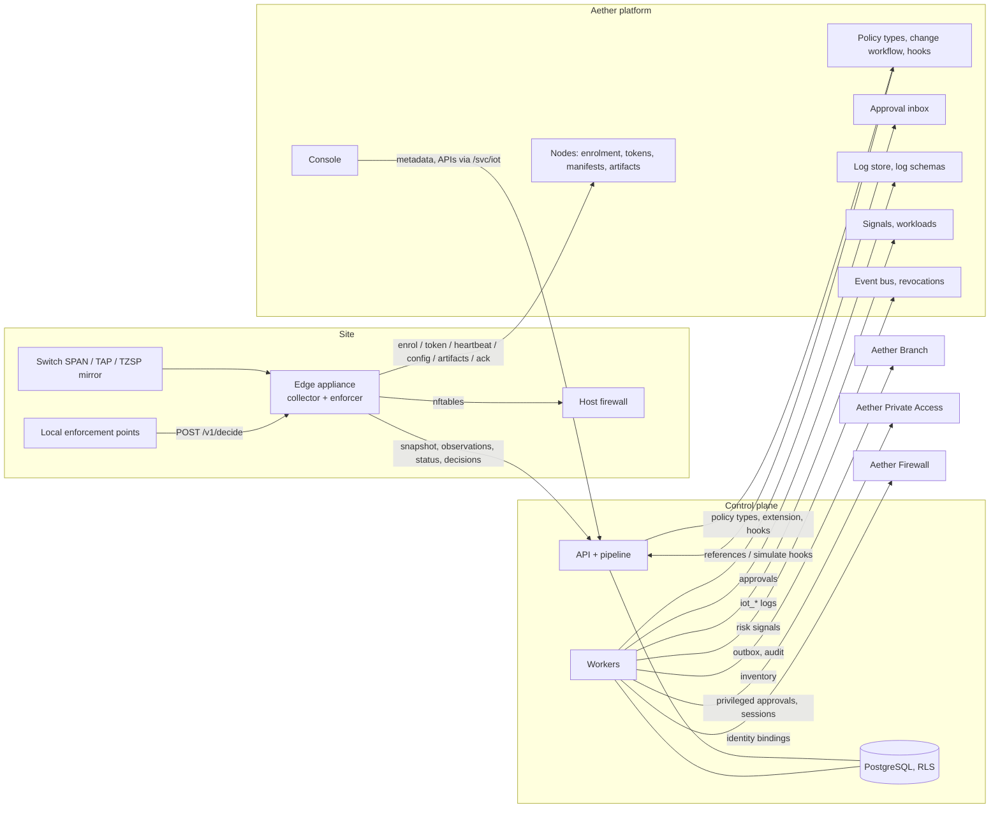
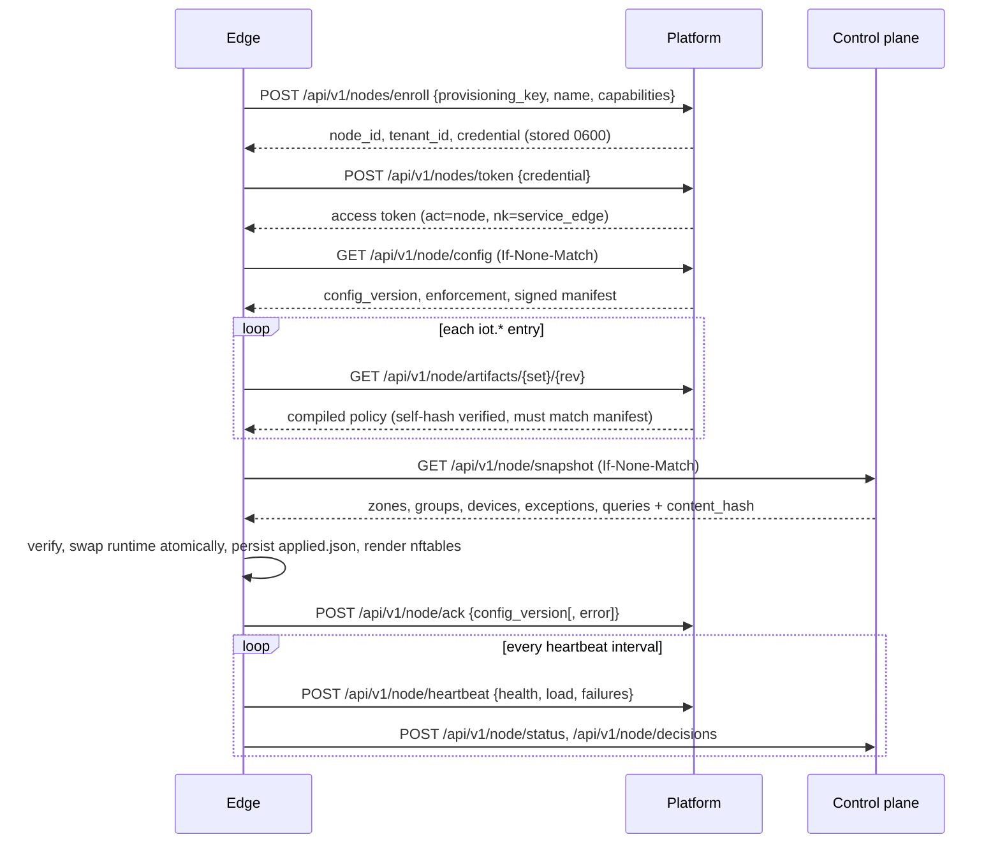
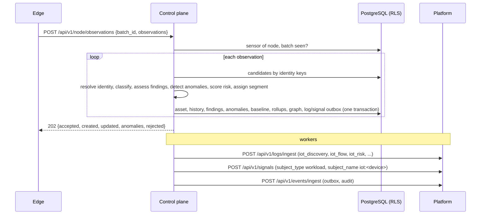
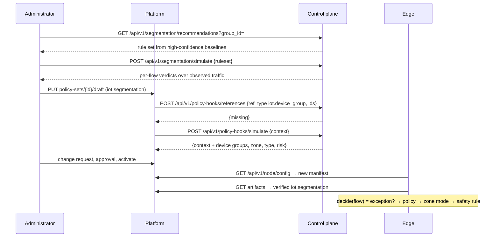

# Architecture

Aether IoT/OT Security consists of three parts:

* **iot-core** — engines without I/O, shared by the control plane and the
  edge: frame decoding, protocol parsers, fingerprinting, the collector,
  the classifier, identity resolution, risk, the vulnerability feed,
  baselines and anomaly detection, the communication graph, segmentation,
  policy types and context builders, remote-access rules, active-query
  governance, assertions, the failure-mode catalogue and the acceptance
  harness. Deterministic, bounded, unit-tested and fuzz-tested.
* **control plane** (`aether-iot serve`) — the product API, the ingestion
  pipeline and background workers on PostgreSQL with row-level security per
  tenant. Stateless; scales horizontally.
* **edge appliance** (`aether-iot edge`) — a platform node of kind
  `service_edge` installed on a site: passive collector, local decision
  point and nftables renderer.



## Data flow

1. **Capture.** The edge reads capture files from a spool directory and
   TZSP datagrams. Each frame is decoded (Ethernet, 802.1Q, ARP, IPv4/IPv6,
   TCP/UDP) with hard size limits; payloads are handed to the matching
   fingerprint or protocol parser (by port, then by signature) and dropped.
   A parser failure is contained (counted, frame dropped).
2. **Collection.** The collector keys devices by MAC (by IP behind a
   gateway MAC that sources many addresses) and accumulates signals
   (de-duplicated) and flow summaries (peer, transport, server port,
   direction, protocol, highest operation class, operations). Memory is
   bounded by device, flow and signal limits.
3. **Shipping.** Observations are drained into batches with idempotent
   batch ids into a bounded queue (oldest dropped and counted when the
   control plane is unreachable) and posted to
   `/api/v1/node/observations`.
4. **Ingestion.** The control plane authenticates the node token, rejects
   non-edge node kinds, maps the node to its registered sensor and site,
   sanitises every observation (clipping, timestamps, limits) and processes
   observations under a concurrency semaphore (429 beyond it). A batch id
   seen before returns the original outcome.
5. **Identity.** Keys (MAC unless randomised, serial, hostname, DHCP
   client id, TLS fingerprint, IP only as a weak hint) resolve to an
   existing asset or create one; conflicts raise merge candidates.
6. **Evaluation.** Per asset: classification (facts from signals and
   behaviour, tenant rules, learned rules, overrides), firmware records,
   findings (vulnerabilities from the feed, end of life, default and
   cleartext credentials, insecure protocols), baseline learning or
   detection (anomalies, alerts), risk (factors, impact, priority),
   segment assignment (groups, zone, quarantine), change events, typed
   logs and risk signals.
7. **Distribution.** Nodes poll `/api/v1/node/snapshot` (zones, groups,
   device memberships, approved exceptions and active queries) with a
   content hash and ETag; policies come as platform artifacts.

## Sequences

### Edge enrolment and configuration



On restart the edge restores `applied.json` (re-verifying every artifact
and the snapshot hash) and enforces it before the platform is reachable
(ZTE-IOTINV-153167). A tampered or mismatched artifact is never applied;
the error is acknowledged and the previous configuration stays in force.

### Discovery and classification



### Segmentation policy



Decision rules (iot-core `segmentation::decide`): an approved, unexpired
exception allows; without a loaded policy the edge observes only; a
restrictive action is enforced only in `enforce` zones, and against a
safety-sensitive destination only when an explicit, approved rule (not the
default or a fail-secure result) matched (ZTE-IOTINV-153168). Stale risk
context fails secure inside the policy evaluation.

### Privileged remote access

```mermaid
sequenceDiagram
  participant V as Requester (vendor automation / admin)
  participant C as Control plane
  participant P as Platform approval inbox
  participant O as Asset owner
  participant PA as Aether Private Access
  V->>C: POST /api/v1/access-requests {target, vendor, window, justification, ticket}
  C->>C: validate window, principal, vendor scope; evaluate iot.remote_access
  C->>P: POST /api/v1/approvals {kind iot_remote_access, requester_admin_id, required_permission}
  O->>P: POST /api/v1/auth/reauth; POST /approvals/{id}/approve
  Note over P: the requester can never decide (separation of duties)
  C->>P: GET /api/v1/approvals?state=approved,denied&since_version=1 (worker)
  C->>PA: POST /api/v1/privileged-approvals {email, application_ids, start_time, end_time}
  V->>C: POST /api/v1/access-requests/{id}/sessions (inside the window only)
  C-->>V: launch {console_id, grant_ref} (credentials stay in the broker)
  loop supervision
    C->>C: window end / max duration / idle / revoke → end session
    C->>PA: terminate, read sessions and recording metadata
  end
```

## State

| Store | Content |
|---|---|
| PostgreSQL (product) | configuration resources, assets and identities, history, baselines and snapshots, rollups and graph, findings, anomalies, alerts, access requests and sessions, revisions, active queries, evidence, outboxes; every table has `tenant_id` and an RLS policy; the application role is `NOSUPERUSER NOBYPASSRLS` (asserted at start-up) |
| Platform | policy sets and revisions, approvals, nodes, logs, signals, events |
| Edge state directory | node credential (0600), last applied configuration (`applied.json`, verified on load) |
| Memory | classifier and policy caches (30 s TTL, invalidated on change), revocation feeds, collector state |

Append-only tables (`asset_changes`, `evidence`, `acceptance_runs`) reject
updates and deletes by trigger; retention purges are allowed only inside
the housekeeping transaction (`app.retention_purge`).

## Conventions

`/api/v1` envelopes `{data, meta}`, RFC 9457 problems with stable codes,
`If-Match` on updates (`428`/`412`), `Idempotency-Key` on creates, cursor
pagination, audit and outbox event on every mutation, permissions
`policy.iot:{read,create,update,delete,activate}`, entitlement `iot`, node
actors refused on administrative APIs and administrators on node APIs,
secrets encrypted with a versioned keyring, fail-secure decisions.

## Failure behaviour

The 17 failure modes of the volume (sensor loss, packet loss, duplicate
observations, IP change, MAC randomisation, classification ambiguity,
parser crash, malformed industrial packet, branch loss, policy stale, graph
lag, risk feed stale, cloud outage, site isolation, time skew, storage
backlog, upgrade interruption) are defined in `iot-core/src/failure.rs`
with detection, safety and security impact, fallback, recovery, alert and
operator action, evaluated from measured health on the edge (heartbeat and
status) and served by `GET /api/v1/failure-modes`.
